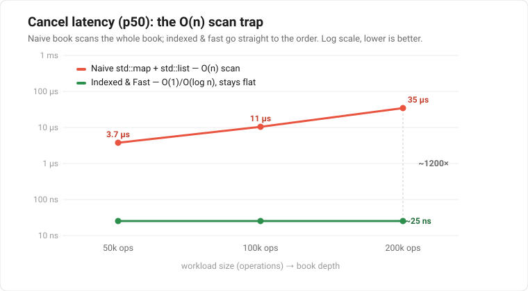

# Low-Latency Matching Engine (C++20)

[](https://github.com/KunalBharadwaj/cpp-matching-engine/actions/workflows/ci.yml)


A single-instrument limit-order-book and matching engine with **price-time
(FIFO) priority**, built twice: once the obvious, correct way, and once the
fast way — then the fast build is proven identical to the correct one by
differential testing and measured against it.

The point isn't just that it matches orders. It's that every performance
decision is **deliberate, explained, and benchmarked**: O(1) cancel/modify
run ~800× faster at the median than the naive book at a realistic workload,
and the gap *grows with book depth* — exactly as the Big-O predicts.

> Single-threaded hot path · header-only engine · C++20 · GoogleTest ·
> clean under AddressSanitizer + UBSan.

---

## Results at a glance

Identical workload (200,000 ops, ~70% adds / 15% cancels / 15% modifies,
prices clustered around a mid) driven through both books on a 12th-gen
Intel i5-1235U, g++ 13.3, `-O3 -DNDEBUG`. Both books produced the **same
119,563 trades** — the benchmark cross-checks that.

Full latency distribution (nanoseconds), both books, same run:

| Operation | Book      |     p50 |      p90 |      p99 |    p99.9 |
|-----------|-----------|--------:|---------:|---------:|---------:|
| add       | naive     |     112 |      199 |      389 |    2,431 |
| add       | **fast**  |  **86** |  **178** |  **306** |  **469** |
| **cancel**| naive     |  46,069 |  120,738 |  189,018 |  561,183 |
| **cancel**| **fast**  |  **56** |  **135** |  **290** |  **529** |
| **modify**| naive     |  51,623 |  125,263 |  189,555 |  541,061 |
| **modify**| **fast**  |  **55** |  **167** |  **364** |  **598** |

**Throughput:** 0.06 M ops/s → **7.44 M ops/s** (~124×). Cancel and modify are
the story — roughly **800× faster at the median and into four figures in the
tail** — because the naive book scans (O(book size)) while the fast book
unlinks in O(1). `add` is close (~1.3×): it was never the bottleneck.

The headline speedup is not a fixed number — it *scales*, because the naive
cancel/modify are O(book size) while the fast ones are O(1):

<p align="center">
  
</p>

| Workload size | Naive cancel p50 | Fast cancel p50 | Naive throughput | Fast throughput |
|:-------------:|-----------------:|----------------:|-----------------:|----------------:|
| 50,000 ops    |         4,773 ns |         **41 ns** |      0.50 M ops/s |    **8.67 M ops/s** |
| 100,000 ops   |        14,515 ns |         **42 ns** |      0.17 M ops/s |    **8.94 M ops/s** |
| 200,000 ops   |        46,069 ns |         **56 ns** |      0.06 M ops/s |    **7.44 M ops/s** |

The naive book degrades as it fills; the fast book is flat. That divergence —
not any single number — is the result.

---

## Try it in 30 seconds

```sh
cmake -S . -B build && cmake --build build --target engine
./build/engine
```

A narrated demo walks a live book through every operation — resting orders, a
crossing limit, a market order sweeping levels, cancel, modify (both the
priority-keeping reduce and the repricing cross), and IOC/FOK — printing the
trades and the book ladder after each step:

```
[12] NEW  #9  BUY     4 @ 105  buy 4 @ 105: #7 (3) fills first, then #8 (1) -- priority proven
      → TRADE     3 @ 105    (maker #7  taker #9)
      → TRADE     1 @ 105    (maker #8  taker #9)
           price    bid    ask
             105             4
        --------------------------
        best bid -   best ask 105
```

---

## What it does

Maintains an order book and matches incoming aggressive orders against resting
liquidity by price-then-time priority, emitting a stream of trades. Supported:

- **Limit** orders — match on cross, rest the remainder.
- **Market** orders — sweep best-available, never rest.
- **Cancel** by order id.
- **Modify (cancel-replace)** — same-price size *decrease* keeps queue
  priority (shrink in place); a reprice or size *increase* goes to the back and
  may cross immediately.
- **Time-in-force**: **GTC**, **IOC** (fill now, drop remainder),
  **FOK** (fill completely now or do nothing).

Core invariant held after every operation: the book is never crossed, and
quantity is conserved across resting + filled.

---

## Architecture

The pipeline is split into seams so the slow parts can be swapped for fast ones
without touching the rest:

```
EventSource ──▶ OrderBook / FastOrderBook ──▶ ExecutionSink
 (ingress)          (match + rest)              (trades out)
```

- **`EventSource`** — abstract order ingress (a vector replayer today; a file
  or network feed could drop in behind the same interface).
- **`OrderBook`** — the naive reference implementation (`std::map`+`std::list`).
- **`FastOrderBook`** — the optimized implementation (below).
- **`ExecutionSink`** — abstract trade/report output (`RecordingSink` for tests,
  a counting sink for benchmarks).

The hot path stays free of heap allocation and avoids virtual dispatch inside
the book (order type and side are enum branches, not polymorphism).

---

## Design: why the fast book is fast

Three changes, each with a tradeoff worth defending in an interview.

### 1. Price levels → flat "price ladder"

Prices are discrete ticks in a bounded range, so index straight into an array:

```
idx = (price - min_price) / tick_size
```

A `vector<PriceLevel>` per side gives **O(1)** access to any level, contiguous
in memory, versus the map's O(log n) red-black-tree pointer-chase. Two integer
cursors, `best_bid_idx` / `best_ask_idx`, replace what `map::begin()` gave the
naive book and are advanced when a level empties.

**Tradeoff:** memory is proportional to the price *range*, not the order count,
and cursor advance across a run of empty levels is amortized, not worst-case
O(1). Fine for one instrument with realistic tick bounds; a very wide/sparse
range would want a hash-of-levels instead.

### 2. Orders within a level → object pool + intrusive doubly-linked FIFO

Resting orders live in one preallocated `vector<PoolNode>` with a free list —
**no `malloc` on the hot path**. The FIFO links (`next`/`prev`) are *intrusive*
(inside the node) and stored as **pool indices, not pointers**, so the pool can
grow and reallocate without dangling, and each link is 4 bytes instead of 8.

**Doubly-**linked is a deliberate choice: it makes unlink **O(1)**, which is the
hook the next change relies on.

Layout is kept tight on purpose: `Order` is 40 bytes (the three one-byte enums
— side, type, time-in-force — fit in the trailing padding, costing nothing),
and a pool node is 48 bytes (`Order` + two 4-byte index links). Indices rather
than 8-byte pointers keep the links small and reallocation-safe.

### 3. Order registry → `OrderId → pool index`

A hash map from order id to pool index means cancel/modify go *straight* to the
node and unlink in O(1) — no scanning. This is the single change behind the
~800× cancel/modify speedup.

**Honest note:** this uses `std::unordered_map` today. An open-addressing flat
hash map (`ankerl::unordered_dense`, Abseil `flat_hash_map`) would cut the
constant further by being cache-friendlier; it's the first item on the roadmap.

---

## Correctness

A fast engine that fills wrong is worthless, so correctness is enforced first:

- **Differential testing** — the headline technique. A 5,000-operation random
  stream (limit/market, GTC/IOC/FOK, cancel, modify) is fed to *both* the fast
  book and the naive oracle, asserting **identical trades and identical
  top-of-book after every single operation**. The fast book's whole reason to
  exist is to match the oracle exactly; this proves it does.
- **Targeted unit tests** for each order type and the nasty edges: partial
  fills, market-into-empty-book, IOC dropping its remainder, FOK killing on
  insufficient liquidity, modify keeping vs. losing priority, cursor repair on
  cancel, object-pool growth under load.
- **25 GoogleTests**, all green under `-fsanitize=address,undefined`.

---

## Benchmarks

### Methodology (how the numbers above were produced)

- **Workload is pre-generated** into a vector before timing — generation cost
  is never inside the measured region.
- **Each operation is timed individually** with `std::chrono::steady_clock`;
  latencies land in a pre-reserved vector and are percentiled *after* the run.
- **Reported per op kind** (add / cancel / modify) — a blended mean would hide
  the cancel story, which is the whole point.
- **Counting sink** (no allocation, no I/O) so the book is measured, not
  bookkeeping.
- **Trade counts are cross-checked** between the two books every run.
- **Release build, `-O3 -DNDEBUG`, sanitizers off** — ASan inflates latency
  several-fold, so perf numbers never come from the test build.
- **Clock overhead is reported and acknowledged.** A back-to-back
  `steady_clock::now()` costs ~20 ns on this box (measured each run) — the
  noise floor. The fast book's ~55 ns p50 sits just above it, so its *true*
  per-op latency is lower than the raw figure; the measurement is partly the
  clock itself. (`rdtsc` or batched timing would resolve below the floor — a
  roadmap item.)
- **Deterministic & reproducible.** The workload is seeded, so a given
  `(num_ops, seed)` replays byte-identically — the same run every time, which
  is what makes the numbers above reproducible and any regression debuggable.
- **Known limitation:** the thread is *not* pinned to a core and turbo /
  frequency scaling is left on, so absolute latencies (especially the tails)
  would tighten under `taskset` + a fixed clock on an isolated box. The
  *relative* naive-vs-fast comparison — same machine, same workload, back to
  back — is robust to this, and the asymptotic gap is the point regardless.

### Interpreting the gap

- **add** barely moves (~1.3× p50): both do O(1)/O(log n) placement plus a list
  push. The ladder wins on cache locality and by avoiding tree rebalancing and
  per-node allocation, but `add` was never the bottleneck.
- **cancel / modify** is where the design pays off. The naive book holds no
  handle to a resting order, so it **scans** — O(book size) — and the cost
  climbs as the book deepens. The fast book jumps to the node via the registry
  and unlinks O(1). **Flat vs. size-dependent** is the result; the scaling
  table above is the proof.

Numbers are single-machine and directional, not promises — reproduce them on
your own box with the command below.

---

## Build & run

Requires CMake ≥ 3.20 and a C++20 compiler (tested on g++ 13.3). GoogleTest is
fetched automatically.

```sh
# Tests
cmake -S . -B build
cmake --build build --target unit_tests
ctest --test-dir build --output-on-failure

# Tests under sanitizers (development)
cmake -S . -B build-asan -DENABLE_SANITIZERS=ON
cmake --build build-asan --target unit_tests && ./build-asan/unit_tests

# Benchmark (release-optimized)
cmake -S . -B build -DCMAKE_BUILD_TYPE=Release
cmake --build build --target bench
./build/bench [num_ops] [seed]        # default: 200000 ops, seed 42
```

See [`benchmarks/RESULTS.md`](benchmarks/RESULTS.md) for the full output and
machine details.

---

## Project layout

```
include/engine/
  types.hpp              OrderId / Price / Quantity, Side, OrderType, TimeInForce
  order.hpp  trade.hpp   core structs
  event_source.hpp       ingress interface + vector replayer
  execution_sink.hpp     trade-output interface + recording sink
  command.hpp  engine.hpp the pull-loop runner
  order_book.hpp         naive reference book (the oracle)
  fast_order_book.hpp    price ladder + object pool + intrusive list + registry
tests/                   GoogleTest suites (incl. the differential test)
benchmarks/              bench harness + RESULTS.md
```

---

## Roadmap

In rough order of value:

1. **Open-addressing flat hash** for the registry — the next constant-factor win.
2. **Real NASDAQ ITCH replay** — swap synthetic flow for a real tape via an
   ITCH parser, so the numbers come from production order flow.
3. **`rdtsc` / batched timing** to measure below the clock-read floor.
4. Templated engine `run()` over book type to drive both through one loop.
5. **Concurrency (stretch):** split ingress and matching across threads over an
   SPSC lock-free ring buffer; multi-instrument sharding.

---

## License

[MIT](LICENSE).
